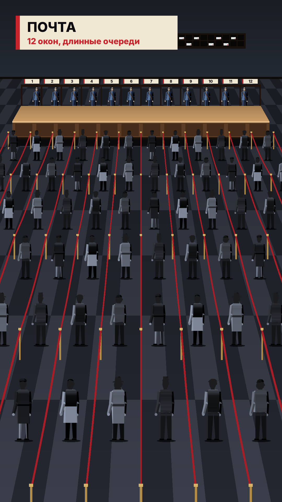
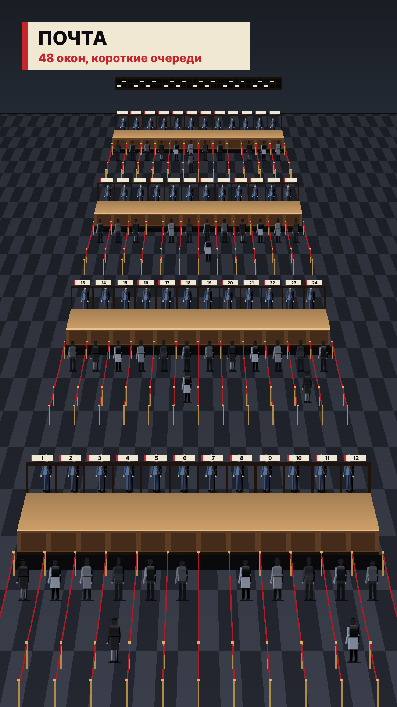
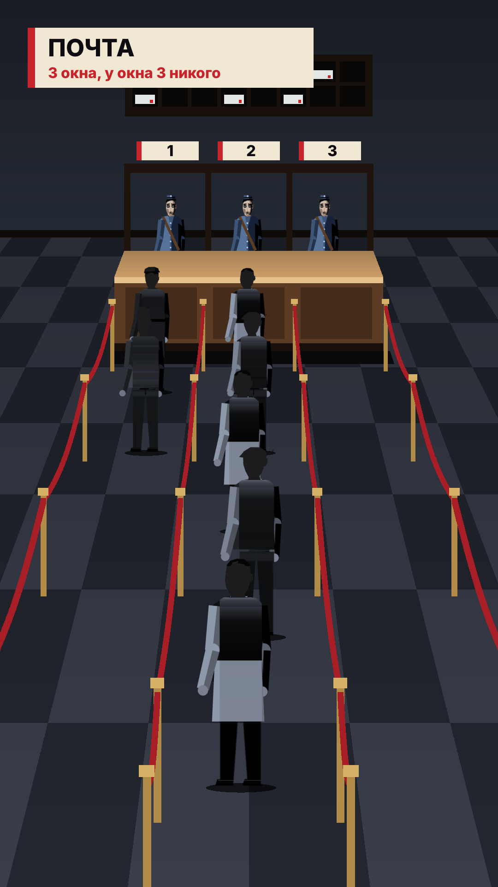

# Место из частей

Сейчас место в ролике — готовая картинка. Предлагаю собирать зал из частей под историю: сколько окон, сколько людей в очереди к каждому.

## Как сейчас

В noir 10 мест. У каждого готовый фон `bg/*.png` и точки, прибитые в `scenes.json`: где ноги очереди, где ячейки, где клерк. Число ячеек и мест в очереди задано картинкой. Поэтому почта всегда одна и та же: 24 ячейки, очередь из 5 человек.

Ветка `notask/inspiring-mccarthy-1c3148` уже рисует почту кодом: от 1 до 8 окон в ряд, клерк в каждом, очередь спиной к зрителю. Это шаг в нужную сторону, но камера одна и та же. 12 окон уже не влезают по ширине, 48 — тем более.

Другие стили:

| стиль | место | что можно менять |
|---|---|---|
| paper, moe | фон-настроение на весь кадр | ничего, пространства нет |
| pixel | цвет стены, цвет пола, линия пола | только цвета и высоту пола |
| park | большая карта, кадр — окно в ней | очереди размечены руками в `queues.json`, длина ограничена |
| rts | карта из плиток | плитки и объекты, людей рисует толпа |
| noir | готовый фон + точки | ничего, кроме того, что разрешено картинкой |

## Что повторяется

В местах noir, где стоят люди, повторяются одни и те же части:

| часть | где встречается |
|---|---|
| пол | везде |
| задняя стена | почта, холл, хранилище, киоск |
| стойка с окнами | почта (окна выдачи), холл (стойка портье), киоск (окно) |
| стеллаж на стене: ячейки, крючки, полки | почта (письма), холл (ключи), архив (карточки) |
| дорожка очереди: столбики и канат | вход (канат), почта |
| свет: лампа над окном | везде, сейчас нарисован в фоне |
| люди за стойкой | почта (клерк), холл (портье), хранилище (бухгалтер) |
| очередь к окну | почта, улица |
| толпа | вход, холл |

Кабинет, допросная и архив — крупные планы, а не залы. Их не трогаем.

## Как описать зал в сцене

```json
"place": {"room": "post", "windows": 12, "queue": 6}
"place": {"room": "post", "windows": 48, "queue": [1, 2, 0, 1]}
```

- `room` — набор частей и цветов: `post` — стойка с окнами, ячейки с письмами на стене, плитка на полу.
- `windows` — сколько окон, от 1 до 48.
- `queue` — сколько людей у каждого окна: одно число на все окна или список по окнам.
- `per_row` — сколько окон в одном ряду, по умолчанию до 12.

Раскладку движок считает сам:

1. Ряд стойки вписывается в ширину кадра 1080.
2. Больше 12 окон — ряды стоек ставятся друг за другом в глубину.
3. Высота камеры подбирается так, чтобы зал занял кадр от плашки до низа. Длинная очередь — камера выше, люди не заслоняют друг друга.
4. Размер людей считается от глубины, где они стоят.

Клерк встаёт в каждое окно сам. Своего героя ставят в `cast` со `"slot": "clerk3"`. Очередь к окну задаётся `"window": 3`, как в ветке почты.

## Чтобы кадр читался

- Пол холодный: серо-синяя плитка в перспективе, темнее у стены.
- Стойка тёплая: светлый верх с яркой кромкой, тёмный деревянный фасад, чёрная тень на полу у основания. С полом не спутать.
- Очередь всегда стоит спиной к зрителю, лицом к своему окну. Первый — у окна, хвост — к зрителю.
- Каждое окно — отдельная дорожка: латунные столбики с красным канатом от стойки к зрителю. Видно, какая очередь к какому окну.
- Над окном табличка с номером. Если она меньше 11 пикселей, номер не пишется.

## Пробные кадры

Отдельная программа вне движка, те же спрайты noir.

| 12 окон, по 6 человек | 48 окон, по 1–2 человека | 3 окна: 2, 5 и никого |
|---|---|---|
|  |  |  |

## Старые сцены

`"place": "post"` строкой работает как раньше: готовый фон и точки из `scenes.json`, либо почта из ветки `inspiring-mccarthy`, если её вольют. Новый путь включается только объектом с `room`. Остальные девять мест не меняются.

## Ограничения

- При 48 окнах люди в дальнем ряду ростом около 70 пикселей, номера на дальних рядах не пишутся.
- Камера смотрит сверху, а спрайты нарисованы на уровне глаз. На кадрах это не мешает, но это заметно.
- Первый шаг — только `post`. Холл с крючками, вход с канатом и банк собираются из тех же частей, это следующие шаги.
